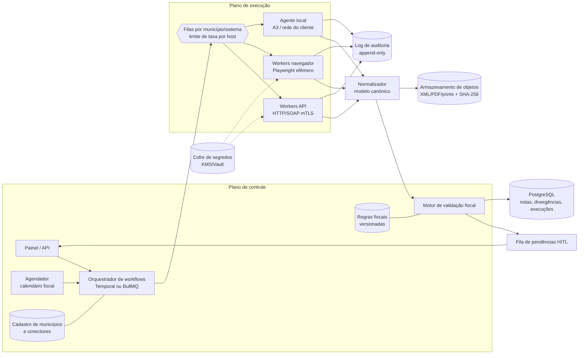
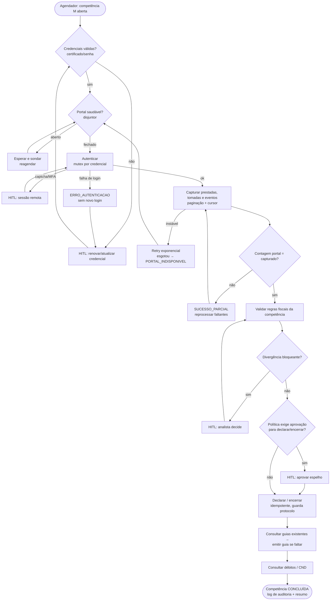
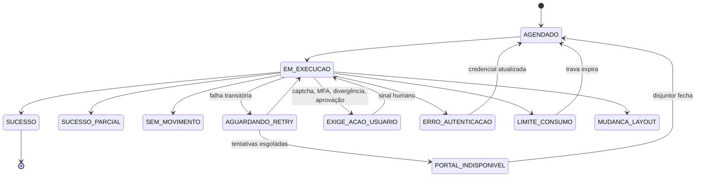

# Arquitetura de Robôs RPA Fiscais — ISS e NFS-e

> **Status:** documento de arquitetura (alvo). O Buscador NFS-e implementa hoje a captura via **ADN/NFS-e Nacional**
> (seção 4.1). Os conectores municipais (seções 4.2 a 4.7) são o roteiro de evolução.
> **Público:** desenvolvedores do robô, analistas fiscais que definem regras e quem opera a fila de pendências.

---

## Sumário

1. [Princípios de projeto](#1-princípios-de-projeto)
2. [Base normativa do ISSQN que o robô precisa respeitar](#2-base-normativa-do-issqn-que-o-robô-precisa-respeitar)
3. [Rotina operacional genérica (step-by-step)](#3-rotina-operacional-genérica-step-by-step)
4. [Conectores por sistema/prefeitura](#4-conectores-por-sistemaprefeitura)
5. [Tabela de mapeamento por sistema](#5-tabela-de-mapeamento-por-sistema)
6. [Validação fiscal e regras de divergência](#6-validação-fiscal-e-regras-de-divergência)
7. [Arquitetura técnica e execução em nuvem](#7-arquitetura-técnica-e-execução-em-nuvem)
8. [Resiliência e tratamento de falhas](#8-resiliência-e-tratamento-de-falhas)
9. [Human-in-the-loop (HITL)](#9-human-in-the-loop-hitl)
10. [Ciclo de vida de uma competência (diagramas)](#10-ciclo-de-vida-de-uma-competência-diagramas)
11. [Catálogo de status de execução](#11-catálogo-de-status-de-execução)
12. [Log de auditoria (payload JSON)](#12-log-de-auditoria-payload-json)
13. [Segurança, LGPD e limites éticos/legais](#13-segurança-lgpd-e-limites-éticoslegais)
14. [Roteiro de implementação a partir do Buscador atual](#14-roteiro-de-implementação-a-partir-do-buscador-atual)

---

## 1. Princípios de projeto

| # | Princípio | Consequência prática |
|---|-----------|----------------------|
| P1 | **API oficial antes de tela.** | Ordem de preferência: (1) API REST/SOAP oficial com certificado; (2) exportação oficial do portal (XML/TXT/CSV); (3) automação de navegador. Só se cai para o nível seguinte quando o anterior não oferece a operação. |
| P2 | **Leitura é automática; efeito fiscal exige política.** | Baixar, conferir e alertar é sempre automático. Rejeitar nota, encerrar competência, retificar declaração e emitir guia passam por **regra aprovada + trilha de aprovação** (seção 9). **Pagar nunca é automático.** |
| P3 | **Idempotência por chave natural.** | Toda operação tem chave (`cnpj+im+competência+rotina`). Reexecutar não duplica nota, declaração ou guia. |
| P4 | **Um conector = um contrato.** | Cada sistema municipal implementa a mesma interface (seção 7.2) e declara uma **matriz de capacidades**. O orquestrador não conhece detalhes de tela. |
| P5 | **Falhar alto, falhar classificado.** | Nenhuma execução termina com "erro genérico". Todo resultado cai num status do catálogo (seção 11), com causa, evidência e próxima ação. |
| P6 | **Respeito ao portal.** | Limite de taxa por host, janelas de execução fora do pico e nenhuma técnica para contornar captcha ou bloqueio (seção 13). Um robô bloqueado não entrega nada. |
| P7 | **Evidência reprodutível.** | Cada passo relevante guarda o artefato original (XML/PDF/HTML/print) com hash SHA-256 e a versão do conector que o produziu. |

---

## 2. Base normativa do ISSQN que o robô precisa respeitar

O robô não interpreta a lei: ele **aplica regras parametrizadas** que um analista fiscal mantém. Estas normas definem as regras padrão.

| Norma | O que importa para a automação |
|---|---|
| **LC 116/2003** | Lista de serviços (itens/subitens → `cTribNac`/código municipal). **Art. 3º:** regra geral, o ISS é devido no local do estabelecimento prestador, com exceções (incisos I a XXV, como construção civil 7.02/7.05 no local da obra). **Art. 6º, §2º:** responsabilidade do tomador PJ pela retenção em subitens específicos (3.05, 7.02, 7.04, 7.05, 7.09, 7.10, 7.12, 7.16, 7.17, 7.19, 11.02, 17.05, 17.10) e serviços vindos do exterior. **Art. 8º:** alíquota máxima de 5%. |
| **LC 157/2016** (art. 8º-A da LC 116) | Alíquota mínima de 2%, salvo exceções legais. Alíquota efetiva abaixo disso é **alerta**. |
| **LC 123/2006** (Simples Nacional) | ISS no DAS (não há guia municipal para o ISS próprio). **Art. 21, §4º:** retenção pelo tomador à alíquota informada na nota. MEI recolhe valor fixo no DAS-MEI e **não sofre retenção** por padrão. |
| **DL 406/1968, art. 9º, §§1º e 3º** | ISS fixo de autônomos e sociedades uniprofissionais (SUP). A base não é a nota; o robô **não calcula** ISS proporcional. |
| **LC 175/2020** | Padrão nacional de obrigação acessória para serviços do art. 3º, XXIII a XXV (planos de saúde, administração de cartões, leasing etc.). Conector próprio. |
| **LC 214/2025** (Reforma Tributária) | Transição do ISS para o IBS (redução gradual 2029–2032, extinção em 2033). Padronização da NFS-e Nacional e compartilhamento com o ADN. **O modelo de dados precisa aceitar IBS/CBS na mesma nota** (campos novos do leiaute nacional). |
| **Legislação municipal** | Prazos de vencimento, regras de substituição tributária locais, cadastros de prestadores de fora (ex.: **CPOM** de São Paulo), regime de declaração do tomador, multas e juros. Mantida em **tabela de parâmetros por município, versionada por vigência**. |
| **CTN arts. 150, §4º e 173** | Decadência de 5 anos: horizonte de busca retroativa e de guarda de evidências. |

> **Regra de engenharia:** toda regra fiscal tem `vigencia_inicio`, `vigencia_fim`, `fonte_legal` e `municipio` (ou
> "nacional"). A conferência de uma competência usa as regras vigentes **naquela competência**, não as de hoje.

---

## 3. Rotina operacional genérica (step-by-step)

Cada conector implementa os passos que o portal oferece; os que não existem são marcados `NAO_SUPORTADO` na matriz de capacidades.

### 3.1 Autenticação e acesso

| Mecanismo | Como o robô trata | Edge cases |
|---|---|---|
| **Certificado A1 (mTLS)** | `.pfx` decifrado só em memória, convertido em PEM (ver `src/crypto/certificado.js`), usado no TLS do cliente HTTP ou no contexto do navegador (`clientCertificates` do Playwright). | PFX antigo com RC2/3DES que o OpenSSL 3 recusa (já tratado via node-forge); certificado da **matriz** usado para **filial** (mesma raiz de CNPJ); certificado **e-CPF do sócio/contador com procuração** em vez do e-CNPJ; cadeia ICP-Brasil incompleta no servidor; certificado revogado (o portal retorna 403 sem explicar). |
| **Certificado A3 (token/cartão)** | **Não roda em nuvem.** Duas saídas: (a) **agente local** (serviço Windows) com acesso PKCS#11 ao token, que busca jobs por conexão de saída; (b) **certificado em nuvem** de PSC credenciado (HSM remoto com API de assinatura). | PIN bloqueado após tentativas (contar e parar antes do limite); token desconectado; sessão PKCS#11 expirada; driver do token diferente por fabricante. |
| **Usuário/senha (Senha Web)** | Credencial cifrada (mesmo cofre AES-256-GCM). Login por formulário via HTTP direto quando possível; navegador quando há JS obrigatório. | Senha expirada por política (90 dias); primeiro acesso exige troca; conta bloqueada após N falhas (**nunca** repetir login falho mais de 1 vez); usuário de contador vinculado a várias IMs (selecionar contribuinte depois do login). |
| **gov.br** | Login com certificado (nível ouro) via mTLS funciona sem interação. Login com senha + 2FA → **HITL**. | Mudança de nível de conta; autorização de compartilhamento de dados ("consentimento") pedida no primeiro acesso a cada sistema. |
| **MFA (TOTP/SMS/e-mail)** | Nunca armazenar a semente TOTP de terceiros sem autorização formal. Padrão: **HITL** (seção 9). | Código expira enquanto espera na fila; aplicar timeout e reemitir. |
| **Captcha / hCaptcha / reCAPTCHA** | **Não é contornado.** Preferir caminho sem captcha (webservice com certificado). Se não houver: tarefa HITL "resolver captcha" com sessão remota de navegador (seção 9.3). | Captcha aparece só depois de N acessos (sinal de excesso de consultas: reduzir taxa). |
| **Controle de sessão** | Uma sessão por credencial por vez (**mutex por credencial**). Cookies guardados cifrados com TTL menor que o do portal. | Login em paralelo derruba a sessão anterior; portal com "sessão única" desconecta o usuário humano que estava usando (avisar o escritório e agendar fora do expediente). |

### 3.2 Captura e download (inbound)

1. **Descobrir o universo**: notas prestadas e tomadas da competência (e da anterior, por notas emitidas com atraso).
2. **Listar** com paginação (por página, faixa de número, NSU ou período). Gravar o **cursor** de cada listagem (como `cursor_nsu` no ADN).
3. **Baixar o documento original** (XML assinado sempre que existir; o PDF é complementar).
4. **Baixar eventos**: cancelamento, substituição, manifestação, carta de correção quando o município permite.
5. **Relatórios complementares**: livro fiscal, extrato de declarações, guias emitidas e pagas, conta corrente fiscal.
6. **Normalizar** para o modelo canônico (seção 7.4) e calcular `sha256` do original.
7. **Reconciliar contagem**: total informado pela listagem = total baixado. Diferença → `SUCESSO_PARCIAL` com lista das faltantes.

Edge cases da captura:
- Nota **emitida em uma competência e cancelada em outra**: o cancelamento chega depois; reabrir a validação da competência original.
- **Nota substituída**: a substituta tem outra chave e referencia a substituída; o livro deve conter só a vigente.
- **RPS sem conversão** (lote em processamento): não é nota ainda; consultar de novo depois.
- Listagem do portal **limitada** (ex.: 50 por página, ou período máximo de 31 dias): quebrar o período automaticamente.
- XML com **encoding** declarado diferente do real (ISO-8859-1 × UTF-8) e caracteres inválidos: guardar bytes originais e normalizar só na leitura.
- Mesma nota visível em **dois CNPJs do cliente** (emitente e tomador): deduplicar por chave e empresa, sem descartar.
- Datas: `dhEmi` com fuso, `dCompet` sem fuso. Competência é **sempre** `dCompet` (ou o equivalente municipal), nunca a data de emissão.

### 3.3 Processamento e validação fiscal

- Aplicar as regras da seção 6 a cada nota (prestadas e tomadas).
- **Aceite/rejeição de notas tomadas** (manifestação): só quando o sistema oferece (NFS-e Nacional: eventos de confirmação e rejeição do tomador). Regra padrão: **confirmação automática opcional; rejeição sempre com aprovação humana** e motivo, porque rejeitar tem efeito fiscal para o prestador.
- **Cruzamento de retenções**: ISS retido declarado na nota × responsabilidade legal do tomador × o que foi escriturado ou declarado × guia de ISS retido emitida/paga.
- Gerar **divergências** com severidade (`BLOQUEANTE`, `ALERTA`, `INFO`). Uma divergência bloqueante impede o encerramento automático da competência.

### 3.4 Encerramento e apuração (outbound)

1. **Pré-condições**: captura completa (`SUCESSO`), nenhuma divergência bloqueante aberta, regras da competência aprovadas.
2. **Escrituração de tomados** onde o município exige (declaração do tomador, notas de fora, notas de prestadores sem NFS-e).
3. **Declaração mensal (DMS/DES/livro eletrônico)**: montar a partir do modelo canônico, preferindo a **importação de arquivo** no layout oficial (TXT/XML) a preencher tela campo a campo.
4. **Conferir o espelho**: totais do portal após a importação = totais calculados. Diferença → `EXIGE_ACAO_USUARIO`.
5. **Encerrar a competência** (onde existe esse passo). Guardar o protocolo/recibo.
6. **Retificação**: nunca automática. Abrir tarefa com o diff entre a declaração entregue e a nova apuração.

Edge cases: competência **sem movimento** (alguns municípios exigem declaração "sem movimento"); competência **já encerrada pelo humano** (detectar e não reencerrar); prazo vencido (o portal passa a cobrar multa: alertar e não declarar sozinho).

### 3.5 Guias e certidões

- **Guia de ISS** (próprio fora do Simples, ISS retido como tomador, ISS fixo de SUP): antes de emitir, **consultar guias já emitidas** da competência (idempotência). Emitir com vencimento correto. Juros e multa após o vencimento: calculados pelo portal, nunca pelo robô. Baixar PDF e linha digitável. **Não pagar.**
- **Simples Nacional**: ISS próprio sai no DAS (PGDAS-D); o robô municipal só gera guia do ISS **retido como tomador** ou de diferenças/autuações.
- **Débitos em aberto**: consultar conta corrente fiscal e extrato; cruzar com guias pagas (o portal pode levar D+2 a D+5 para baixar o pagamento).
- **CND / certidão de tributos mobiliários**: emitir, validar autenticidade (código de verificação), guardar PDF e validade. Certidão **positiva com efeito de negativa** é status próprio. Frequência: semanal ou sob demanda (antes de licitação ou financiamento).

---

## 4. Conectores por sistema/prefeitura

> ⚠️ O sistema usado por cada município, as URLs e os nomes de operação **mudam**: migração para a NFS-e Nacional,
> troca de fornecedor, novas versões de leiaute. Tudo abaixo fica num **cadastro configurável**
> (`municipios.json`/tabela), conferido contra o manual vigente de cada prefeitura antes de entrar em produção.
> Os exemplos indicam o padrão de integração, não uma garantia de que o endpoint está ativo hoje.

### 4.1 NFS-e Nacional (ADN / SEFIN Nacional) — **implementado no Buscador**

| Item | Detalhe |
|---|---|
| Autenticação | mTLS com A1 do contribuinte (ou de procurador habilitado). Sem captcha. |
| Captura | `GET /contribuintes/DFe/{NSU}?cnpjConsulta=…&lote=true` (lotes de documentos em base64+gzip), com cursor NSU persistente. Consulta pontual por chave na SEFIN (`/nfse/{chave}`). |
| Eventos | Cancelamento (101101), substituição (105102), manifestações (confirmação/rejeição de prestador, tomador e intermediário), ofício. Códigos já tratados em `src/nfse/parser.js`. |
| Manifestação | Envio de evento assinado (XMLDSig) pela API da SEFIN. **Exige aprovação humana para rejeição.** |
| Apuração/guia | Depende de o município usar os módulos nacionais de apuração e guia; caso contrário, segue no portal municipal (conectores 4.2+). |
| Edge cases | Consumo indevido (HTTP 429/656), com trava por empresa já implementada; notas de municípios **não conveniados** não aparecem no ADN (cair para o conector municipal); NSU com documento ilegível (registrar e seguir, já implementado). |

### 4.2 São Paulo — NFS-e Paulistana

| Item | Detalhe |
|---|---|
| Integração | **Webservice SOAP** (lote NF-e paulistana) com mensagens XML **assinadas com A1**. Operações de consulta típicas: notas **emitidas** e **recebidas** por período (paginadas), consulta por número, consulta de CNPJ (inscrição e situação), consulta de lote. |
| Portal | Login por certificado ou Senha Web. Usado para guias, **NFTS** (nota do tomador para serviços de prestadores sem NFS-e paulistana), extratos e livros. |
| Específico | **CPOM**: tomador paulistano retém ISS de prestador de outro município não cadastrado no CPOM (Lei municipal 14.042/2005); o robô precisa consultar o cadastro do prestador. **Declaração do tomador (NFTS)** para serviços de fora. |
| Edge cases | Período máximo por consulta e paginação: quebrar em janelas; diferença entre "data de emissão" e "data de competência" nas consultas; nota emitida a partir de RPS antigo (prazo de conversão); retenção de órgão público. |

### 4.3 DSF (ISS DSF / "Nota DSF")

| Item | Detalhe |
|---|---|
| Integração | Webservice SOAP próprio (padrão de lote RPS, com operações de envio, consulta de lote, consulta de notas por período, cancelamento e consulta de sequencial de RPS). Certificado A1 assina as requisições. |
| Portal | Portal municipal para livro fiscal, declaração de tomados e guias (DAM). |
| Edge cases | Vários municípios com versões diferentes do mesmo produto (o leiaute varia por cidade); municípios que **migraram** para outro sistema ou para a NFS-e Nacional mantêm histórico no sistema antigo (conectar nos dois por período). Campinas é exemplo histórico de DSF: **confirmar o sistema vigente**. |

### 4.4 GISS Online

| Item | Detalhe |
|---|---|
| Natureza | Foco em **escrituração e declaração** (prestados e tomados), **guias** e conta corrente; em geral não é o emissor da nota. |
| Integração | Portal web (usuário/senha do contribuinte ou do escritório) com **importação de arquivo de escrituração** em leiaute próprio. Preferir **gerar o arquivo e importar** a digitar nota por nota. |
| Acesso | Pode haver captcha no login: caminho **HITL** ou janela agendada com operador. |
| Edge cases | Escritório com acesso a várias empresas (seletor de contribuinte); escrituração **encerrada** que impede importação; nota tomada sem XML (escrituração manual com dados mínimos); guias geradas por competência e por tipo (próprio × retido). |

### 4.5 SigISS

| Item | Detalhe |
|---|---|
| Integração | Webservice (consulta/emissão) e portal para guias, livro e declaração de tomados. |
| Edge cases | Endpoints e versões por município; autenticação por usuário do prestador + certificado em algumas cidades; relatórios em PDF sem equivalente XML (extrair por parser de PDF com teste de regressão). |

### 4.6 Betha (e-Nota e similares)

| Item | Detalhe |
|---|---|
| Integração | Webservice **padrão ABRASF 2.0x** (ex.: consultar NFS-e de serviço **prestado** e **tomado**, por faixa, por RPS, lote). Portal na nuvem Betha para declarações e guias. |
| Edge cases | Versão ABRASF diferente por município (2.01, 2.02, 2.03, 2.04): o mapeamento muda campo a campo; operações de "tomado" nem sempre habilitadas; certificado vinculado a um usuário cadastrado previamente no portal. |

### 4.7 Família ABRASF genérica (IPM, ISSNet, Ginfes, Elotech, Fiorilli, Governa, etc.)

- Um **conector-base ABRASF** parametrizado por versão (1.00, 2.0x), URL, namespace, regra de assinatura (envelope/lote/RPS) e operações habilitadas.
- Subclasses só para os desvios de cada fornecedor.
- **Teste de contrato** (XSD do município) roda antes de cada release do conector.

---

## 5. Tabela de mapeamento por sistema

Legenda de integração: **API** = webservice oficial · **ARQ** = exportação/importação de arquivo oficial · **WEB** = automação de navegador · **HITL** = depende de pessoa.

| Sistema / Prefeitura | Autenticação | Captura (prestadas/tomadas) | Campos capturados (mínimo) | Formatos baixados | Declaração / encerramento | Guias / CND | Frequência ideal |
|---|---|---|---|---|---|---|---|
| **NFS-e Nacional (ADN)** | A1 mTLS | API (NSU) | chave, nº, dCompet, prestador, tomador, intermediário, cTribNac, NBS, município de incidência, valores, ISS, retenções federais, tpRetISSQN, eventos | XML (gzip/base64); PDF gerado localmente | Conforme convênio do município | Conforme convênio | **Diária** (incremental por NSU) + varredura semanal |
| **São Paulo (Paulistana)** | A1 (API) / A1 ou Senha Web (portal) | API (período, paginado) | nº, código de verificação, RPS, datas, prestador/tomador, código de serviço municipal, alíquota, ISS, retenção, CPOM | XML; PDF | NFTS (WEB/ARQ) | Guias (WEB); certidão (WEB) | Diária (emitidas), D+1 a D+3 após o fim do mês (recebidas), semanal (CND) |
| **DSF** | A1 (API) / senha (portal) | API (período) | nº, RPS, datas, serviço, alíquota, ISS, retenção, situação | XML; PDF | Portal (WEB) | DAM (WEB) | Diária + fechamento D+1..D+5 |
| **GISS Online** | Senha (+ captcha eventual) | ARQ/WEB (relatórios) | escrituração de prestados/tomados, guias, conta corrente | TXT/CSV de escrituração; PDF de guias e livro | **ARQ** (importação) + encerramento WEB | Guias (WEB); certidão (WEB/HITL) | Semanal + janela mensal de fechamento |
| **SigISS** | Senha e/ou A1 | API/WEB | nº, datas, serviço, ISS, retenção, situação | XML; PDF | WEB | WEB | Diária + fechamento |
| **Betha** | A1 + usuário vinculado | API ABRASF 2.0x | campos ABRASF (Nfse/InfNfse, ValoresNfse, Servico, Tomador, Intermediario) | XML ABRASF; PDF | WEB | WEB | Diária + fechamento |
| **ABRASF genérico** | A1 | API (prestado/tomado/faixa) | campos ABRASF | XML ABRASF | WEB/ARQ | WEB | Diária + fechamento |
| **Prefeitura sem API** | Senha/gov.br | WEB (+ HITL) | o que a tela exibir; prioridade para PDF/XML baixável | PDF/HTML/CSV | WEB + HITL | WEB + HITL | Semanal (reduz custo de HITL) |

**Calendário recomendado da competência M:**

| Quando | Rotina |
|---|---|
| Diário durante M | Captura incremental de prestadas (detecção precoce de nota errada) |
| M+1, dias 1–3 | Captura completa de prestadas e tomadas de M, eventos e reconciliação de contagem |
| M+1, dias 3–5 | Validação fiscal e fila de divergências para o analista |
| Até D−3 do vencimento municipal | Declaração/encerramento (com aprovação) e emissão das guias |
| Vencimento + 5 dias úteis | Confirmar baixa de pagamento na conta corrente |
| Semanal | CND e varredura de débitos |
| Mensal | Varredura retroativa de 5 competências (notas emitidas ou canceladas com atraso) |

---

## 6. Validação fiscal e regras de divergência

Cada regra tem: `codigo`, `severidade`, `aplica_a` (prestada/tomada), `vigencia`, `fonte_legal` e `acao_sugerida`.

| Código | Regra | Severidade | Observação / edge case |
|---|---|---|---|
| `RET-001` | Tomador PJ e subitem do art. 6º §2º da LC 116 **sem** retenção destacada | BLOQUEANTE | Exceções: prestador MEI; imunidade/isenção comprovada; lei local diferente (parâmetro do município) |
| `RET-002` | Retenção destacada em subitem/situação sem responsabilidade do tomador | ALERTA | Pode ser exigência de lei municipal; risco de recolher duas vezes |
| `RET-003` | Prestador de outro município sem cadastro exigido (ex.: CPOM-SP) e sem retenção | BLOQUEANTE | Consultar o cadastro na data da competência, não na data atual |
| `RET-004` | Prestador Simples com retenção a alíquota diferente da informada na nota | ALERTA | LC 123, art. 21 §4º; alíquota informada deve estar entre 2% e 5% |
| `RET-005` | Prestador MEI com ISS retido | ALERTA | Em regra, MEI não sofre retenção |
| `LOC-001` | Município de incidência divergente da regra do art. 3º para o subitem | BLOQUEANTE | Construção civil, eventos, vigilância, limpeza etc.: local da execução |
| `ALQ-001` | Alíquota efetiva < 2% | ALERTA | Exceções do art. 8º-A, §1º (subitens 7.02, 7.05, 16.01) |
| `ALQ-002` | Alíquota > 5% | BLOQUEANTE | Provável erro de cadastro do serviço |
| `BC-001` | Base de cálculo ≠ serviço − deduções permitidas | ALERTA | Deduções de material (7.02/7.05) dependem de comprovação e de lei local |
| `CMP-001` | Competência da nota ≠ competência em processamento (nota emitida com atraso) | INFO | Reprocessar a competência correta |
| `CAN-001` | Nota escriturada/declarada e depois cancelada | BLOQUEANTE | Exige retificação (HITL) |
| `SUB-001` | Nota substituída presente no livro em vez da substituta | BLOQUEANTE | Trocar pela vigente |
| `DUP-001` | Mesma prestação em duas notas (mesmo tomador, valor, data e descrição) | ALERTA | Pode ser legítimo (parcelas) |
| `CNT-001` | Total do portal ≠ total capturado | BLOQUEANTE | Captura incompleta; não encerrar |
| `GUI-001` | Guia emitida com valor ≠ apuração | BLOQUEANTE | Não emitir outra; abrir tarefa |
| `GUI-002` | Guia vencida e não paga | ALERTA | Com juros e multa do portal |
| `CAD-001` | IM suspensa/baixada ou CNPJ inapto na data | BLOQUEANTE | Consulta cadastral municipal/RFB |

---

## 7. Arquitetura técnica e execução em nuvem

### 7.1 Visão de componentes



### 7.2 Contrato do conector

```ts
interface ConectorMunicipal {
  readonly id: string;                 // "sp-paulistana@3.2.0"
  readonly capacidades: Capacidades;   // matriz: qual operação é API/ARQ/WEB/HITL/NAO_SUPORTADO
  autenticar(ctx: Contexto): Promise<Sessao>;              // não reutiliza sessão de outra credencial
  listarNotas(s: Sessao, q: ConsultaPeriodo): AsyncIterable<RefNota>; // paginação + cursor
  baixarNota(s: Sessao, ref: RefNota): Promise<DocumentoOriginal>;   // bytes + metadados + sha256
  listarEventos?(s: Sessao, q: ConsultaPeriodo): AsyncIterable<EventoOriginal>;
  manifestar?(s: Sessao, ref: RefNota, m: Manifestacao): Promise<Protocolo>;  // exige aprovação
  declarar?(s: Sessao, d: Declaracao): Promise<Protocolo>;                    // exige aprovação
  encerrar?(s: Sessao, c: Competencia): Promise<Protocolo>;                   // exige aprovação
  emitirGuia?(s: Sessao, g: PedidoGuia): Promise<Guia>;                       // idempotente
  consultarDebitos?(s: Sessao): Promise<Debito[]>;
  emitirCertidao?(s: Sessao): Promise<Certidao>;
  saude(): Promise<StatusPortal>;      // usado pelo disjuntor (seção 8)
}
```

Regras do contrato:
- Erros só por **exceções tipadas** que mapeiam 1:1 para o catálogo da seção 11 (`ErroAutenticacao`, `PortalIndisponivel`, `LimiteConsumo`, `MudancaLayout`, `ExigeAcao`, `DadoInconsistente`).
- Operações de **escrita** recebem uma `chaveIdempotencia` e precisam primeiro **consultar se já foram feitas**.
- Todo conector tem **teste de contrato** contra gravações reais anonimizadas (HAR/XML) e um **canário** diário com um CNPJ de teste autorizado.

### 7.3 Estratégias de integração

| Estratégia | Quando usar | Cuidados |
|---|---|---|
| **API oficial REST/SOAP** | Sempre que existir | Assinatura XMLDSig (C14N correta, referência ao `Id`), validação contra o XSD antes de enviar, timeouts por operação, versionamento de leiaute |
| **HTTP direto em endpoint de tela** (formulários/JSON internos do portal) | Portal sem API, mas com fluxo estável e sem captcha | Só endpoints acessíveis ao usuário autenticado e **dentro dos termos de uso**; tratar token anti-CSRF e `ViewState` (ASP.NET); quebra fácil: contrato com gravação de referência e alerta de mudança |
| **Navegador headless (Playwright)** | JS obrigatório, downloads gerados no cliente, fluxos com múltiplas janelas | Contexto **efêmero por credencial**; `clientCertificates` para mTLS; seletores semânticos (`getByRole`/`getByLabel`) em vez de XPath frágil; esperar estado, nunca `sleep`; `trace` e prints guardados em falha; downloads via evento `download`, com verificação de tipo/tamanho |
| **Importação de arquivo oficial** | Declarações (DMS/escrituração) | Gerar o arquivo a partir do modelo canônico, validar o leiaute localmente, guardar o arquivo enviado e o recibo |
| **Parser de PDF** | Relatório só em PDF (livro, extrato) | Extração por coordenadas/regex com teste de regressão por versão do relatório; usar como conferência, nunca como fonte primária de valores quando houver XML |

### 7.4 Modelo canônico (resumo)

`Nota` (chave universal = `sistema + municipio + chave/numero+codigo_verificacao`), `Evento`, `Declaracao`, `Guia`, `Certidao`, `Divergencia`, `Execucao`, `Passo`, `Evidencia`. Valores em **centavos inteiros** (sem ponto flutuante); datas com fuso explícito; competência como `AAAA-MM`. Campos IBS/CBS reservados para a transição da LC 214/2025.

### 7.5 Orquestração e filas

- **Unidade de trabalho:** `(cnpj, inscricao_municipal, municipio, competencia, rotina)`. Os workflows encadeiam rotinas: captura → validação → (aprovação) → declaração → (aprovação) → guia.
- **Filas por sistema/município**, cada uma com **token bucket por host** (ex.: 1 requisição/s e 1 sessão simultânea por credencial, ajustável por município). Isso evita derrubar portais frágeis e ser bloqueado.
- **Mutex por credencial** (lock distribuído com TTL e renovação): nunca duas sessões da mesma senha ou certificado no mesmo portal.
- **Prioridade:** proximidade do vencimento > reprocessamento de erro > captura incremental > varredura retroativa.
- **Escala horizontal:** workers sem estado em contêineres; os de navegador escalam por fila (KEDA ou autoscaling por tamanho da fila); os de API são leves e muitos.
- **Janelas de execução por município** (evitar horário de pico e manutenções conhecidas; muitos portais caem perto do vencimento).
- **Workflows duráveis** (Temporal recomendado): retomam do último passo após queda do worker e aceitam **sinais** humanos (aprovação, captcha resolvido, MFA) sem perder o contexto.
- **Agente local** (evolução natural do Buscador atual): processo no computador do escritório que **busca** jobs por HTTPS de saída (sem abrir portas), para A3 físico ou portais que só aceitam o IP do cliente.

---

## 8. Resiliência e tratamento de falhas

### 8.1 Política de retry

| Classe de erro | Retry? | Política |
|---|---|---|
| Timeout, `ECONNRESET`, 502/503/504 | Sim | Espera exponencial com jitter: `min(base·2^n + rand(0, base), teto)`; base 2s, teto 5 min, máx. 6 tentativas; depois `PORTAL_INDISPONIVEL` e reagendamento em +1h/+4h/+24h |
| 429 / "consumo indevido" | Não (imediato) | Trava a credencial no município (já implementado no ADN: `trava_ate`) e respeita `Retry-After` se vier |
| DNS inexistente, erro de certificado TLS | Não | Erro de configuração: `ERRO_CONFIGURACAO` |
| 401/403, senha errada, certificado recusado | **Nunca** repetir login | Evita bloqueio de conta: `ERRO_AUTENTICACAO` + HITL |
| Seletor/campo não encontrado, XSD inválido na resposta | 1 vez (pode ser carregamento parcial) | Depois `MUDANCA_LAYOUT`: desativa o conector para o município (disjuntor) e alerta o time |
| Erro de negócio do portal ("competência encerrada", "guia já emitida") | Não | Mapear para status específico; geralmente não é erro |

### 8.2 Disjuntor (circuit breaker) por município

- Abre após X falhas `PORTAL_INDISPONIVEL` em Y minutos **de CNPJs diferentes**. É o portal que caiu, não a empresa.
- Aberto: jobs do município vão para espera; uma sonda (`saude()`) roda a cada 10 min; ao fechar, a fila é liberada aos poucos (meio aberto, com taxa reduzida).
- Painel mostra "Prefeitura X instável desde 14h20", em vez de N erros individuais.

### 8.3 Idempotência e consistência

- Notas: `UPSERT` por chave natural (já é assim em `documentos`).
- Escritas (declaração, guia, manifestação): **consultar antes de agir** e gravar o protocolo; se o worker cair entre "enviar" e "gravar protocolo", a próxima tentativa consulta e encontra o envio feito.
- Cursor/paginação gravados **na mesma transação** que os dados do lote (padrão já usado no NSU).

### 8.4 Detecção de mudança de layout

- Teste de contrato noturno por conector (canário).
- Comparar a estrutura do HTML/JSON de referência (hash de seletores-chave) e alertar antes de quebrar em produção.
- Versão do conector no log de cada passo, para reprocessar só o que a versão defeituosa produziu.

### 8.5 Sobre proxies e IPs

- Usar **IP de saída fixo e conhecido** (NAT dedicado). Alguns municípios exigem cadastrar o IP para liberar o webservice.
- **Não usar rotação de proxies para fugir de bloqueio ou limite de consultas.** Isso contorna um controle do portal (seção 13) e costuma acabar em bloqueio do certificado ou do CNPJ. O caminho certo para volume é: limite de taxa, janelas fora do pico, captura incremental (cursor) e, quando existir, a API oficial.

---

## 9. Human-in-the-loop (HITL)

### 9.1 Quando o robô para e pede ajuda

| Gatilho | Tarefa criada | Quem resolve | Prazo/SLA sugerido |
|---|---|---|---|
| Certificado vence em ≤ 30 dias / vencido | Renovar e importar certificado (importação em lote já existe) | Escritório/cliente | 30 dias / imediato |
| Senha inválida, expirada ou conta bloqueada | Atualizar credencial | Escritório | 1 dia útil |
| Captcha sem caminho alternativo | Resolver captcha na sessão remota | Operador | Minutos (a sessão expira) |
| MFA / gov.br 2FA | Informar código ou aprovar no app | Titular da conta | Minutos |
| Termo de uso ou consentimento novo no portal | Ler e aceitar | Responsável legal | 1 dia útil |
| Procuração eletrônica ausente ou vencida | Cadastrar procuração | Cliente | 5 dias úteis |
| Divergência BLOQUEANTE | Analisar e decidir (corrigir, justificar, ignorar com motivo) | Analista fiscal | Antes do encerramento |
| Rejeição de nota tomada | Aprovar ou recusar a rejeição | Analista | 2 dias úteis |
| Encerramento, declaração, retificação | Aprovar o envio (vendo o diff/espelho) | Analista + revisor | Até D−3 do vencimento |
| Débito encontrado / guia vencida | Decidir pagamento ou contestação | Cliente/escritório | Antes do vencimento |
| `MUDANCA_LAYOUT` | Corrigir o conector | Desenvolvimento | Até a próxima janela |

### 9.2 Desenho da fila de pendências

- Cada tarefa tem `tipo`, `empresa`, `municipio`, `competencia`, `prazo`, `bloqueia` (quais jobs estão parados), `evidencias` e `acoes_possiveis`.
- **Deduplicação**: uma tarefa por causa (não 40 tarefas "senha inválida" para o mesmo usuário de escritório).
- Ao resolver, a tarefa **envia um sinal** ao workflow, que retoma do ponto exato.
- Notificações agrupadas (resumo diário), com urgência imediata só para prazo do dia.

### 9.3 Sessão remota para captcha/MFA (sem burla)

O worker abre o navegador num contêiner e transmite a tela para o operador (noVNC/CDP screencast) **apenas no passo** que exige pessoa. O operador resolve, o worker detecta o avanço da página e continua sozinho. Tudo fica gravado na trilha de auditoria (quem, quando, qual tela).

---

## 10. Ciclo de vida de uma competência (diagramas)

### 10.1 Fluxo da execução



### 10.2 Estados de um job



### 10.3 Versão ASCII (para logs e terminais)

```
[AGENDADO] -> credencial ok? --não--> (HITL credencial)
     |sim
     v
 portal ok? --não--> [PORTAL_INDISPONIVEL] -> sonda -> volta
     |sim
     v
 [AUTENTICAR] --captcha/MFA--> (HITL sessão remota)
     |
     v
 [CAPTURAR] -> contagem bate? --não--> [SUCESSO_PARCIAL] -> recaptura
     |sim
     v
 [VALIDAR] -> bloqueante? --sim--> (HITL analista)
     |não
     v
 [DECLARAR/ENCERRAR]* -> [GUIA]* -> [DÉBITOS/CND] -> [CONCLUÍDO]
                                      * com aprovação conforme política
```

---

## 11. Catálogo de status de execução

| Status | Código | Significado | Retry automático | Gera HITL | Ação sugerida |
|---|---|---|---|---|---|
| Sucesso | `SUCESSO` | Rotina completa; contagens conferem | — | Não | — |
| Sucesso parcial | `SUCESSO_PARCIAL` | Parte dos itens falhou (ex.: XML ilegível, nota faltante) | Sim, só os faltantes | Se persistir após 3 ciclos | Ver lista de itens no log |
| Sem movimento | `SEM_MOVIMENTO` | Nenhuma nota na competência | — | Não (exceto declaração obrigatória) | Declarar "sem movimento" se o município exigir |
| Erro de autenticação | `ERRO_AUTENTICACAO` | Subcódigos: `CERT_VENCIDO`, `CERT_SENHA`, `CERT_REVOGADO`, `CRED_INVALIDA`, `CRED_EXPIRADA`, `CONTA_BLOQUEADA`, `PROCURACAO_AUSENTE` | **Não** | Sim | Atualizar credencial/certificado/procuração |
| Portal indisponível | `PORTAL_INDISPONIVEL` | Timeout/5xx/manutenção após esgotar tentativas; disjuntor do município pode estar aberto | Sim (reagendado) | Só se passar de 24h perto do vencimento | Aguardar; avisar o cliente se o prazo correr risco |
| Limite de consumo | `LIMITE_CONSUMO` | 429 ou "consumo indevido" | Após a trava | Não | Reduzir frequência daquele município |
| Exige ação do usuário | `EXIGE_ACAO_USUARIO` | Subcódigos: `CAPTCHA`, `MFA`, `TERMO_USO`, `DIVERGENCIA`, `APROVACAO`, `DEBITO` | Retoma após o sinal | Sim | Resolver na fila de pendências |
| Mudança de layout | `MUDANCA_LAYOUT` | Tela/resposta fora do contrato do conector | Não | Sim (time técnico) | Corrigir o conector; disjuntor do conector aberto |
| Dado inconsistente | `DADO_INCONSISTENTE` | Portal retornou dado contraditório (total ≠ soma, XML ≠ PDF) | 1 vez | Sim | Conferência manual e chamado na prefeitura |
| Erro de configuração | `ERRO_CONFIGURACAO` | Município sem conector, URL errada, IM ausente | Não | Sim | Ajustar cadastro |
| Erro interno | `ERRO_INTERNO` | Bug do robô (exceção não classificada) | 1 vez | Sim (técnico) | Abrir incidente com o trace |
| Cancelado | `CANCELADO` | Interrompido por pessoa ou por desligamento | — | Não | Retomar quando quiser |

---

## 12. Log de auditoria (payload JSON)

Gerado ao fim de cada **lote** (conjunto de CNPJs processados numa janela). Gravado em armazenamento append-only. Cada registro carrega o hash do anterior (`hash_anterior`), o que torna qualquer alteração detectável.

```json
{
  "tipo": "auditoria.lote.finalizado",
  "versao_schema": "1.2.0",
  "lote_id": "lote_2026-11-03T03:00:00-03:00_c7f2",
  "disparo": { "origem": "agendador", "regra": "competencia_fechamento", "usuario": null },
  "competencia": "2026-10",
  "iniciado_em": "2026-11-03T03:00:04-03:00",
  "finalizado_em": "2026-11-03T03:41:57-03:00",
  "duracao_ms": 2513000,
  "ambiente": { "robo": "buscador-nfse@2.0.0", "host": "worker-api-3", "regiao": "sa-east-1", "ip_saida": "200.0.113.10" },
  "resumo": {
    "empresas": 3,
    "status": { "SUCESSO": 1, "SUCESSO_PARCIAL": 1, "EXIGE_ACAO_USUARIO": 1 },
    "notas_capturadas": 412,
    "eventos_capturados": 9,
    "divergencias": { "BLOQUEANTE": 1, "ALERTA": 4, "INFO": 2 },
    "guias_emitidas": 1,
    "tarefas_hitl_abertas": 2
  },
  "empresas": [
    {
      "cnpj": "11222333000181",
      "inscricao_municipal": "1234567",
      "municipio": { "ibge": "3550308", "nome": "São Paulo", "sistema": "sp-paulistana" },
      "status": "SUCESSO",
      "passos": [
        { "rotina": "autenticar", "conector": "sp-paulistana@3.2.0", "metodo": "API", "status": "SUCESSO", "tentativas": 1, "duracao_ms": 820 },
        { "rotina": "capturar_prestadas", "conector": "sp-paulistana@3.2.0", "metodo": "API", "status": "SUCESSO",
          "tentativas": 2, "paginas": 5, "itens_portal": 231, "itens_capturados": 231,
          "falhas_transitorias": [{ "erro": "HTTP 503", "em": "2026-11-03T03:02:11-03:00", "espera_ms": 4180 }] },
        { "rotina": "capturar_tomadas", "conector": "adn-nacional@1.0.0", "metodo": "API", "status": "SUCESSO",
          "cursor": { "tipo": "NSU", "de": 18840, "ate": 18977 }, "itens_capturados": 137 },
        { "rotina": "validar", "status": "SUCESSO", "regras_versao": "regras-2026.10.1",
          "divergencias": [{ "codigo": "ALQ-001", "severidade": "ALERTA", "nota": "35503082112223330001810000000000001226030000000001" }] },
        { "rotina": "emitir_guia", "conector": "sp-paulistana@3.2.0", "metodo": "WEB", "status": "SUCESSO",
          "idempotencia": { "chave": "11222333000181|1234567|2026-10|ISS_RETIDO", "ja_existia": false },
          "guia": { "tipo": "ISS_RETIDO", "valor_centavos": 154320, "vencimento": "2026-11-10", "linha_digitavel_sha256": "9f1c…" },
          "aprovacao": { "politica": "guia_retido_automatica_ate_5000", "aprovado_por": "politica" } }
      ],
      "arquivos": [
        { "tipo": "XML_NFSE", "quantidade": 368, "armazenamento": "s3://nfse/11222333000181/2026-10/", "manifesto_sha256": "a41e…" },
        { "tipo": "PDF_GUIA", "caminho": "s3://nfse/11222333000181/guias/2026-10-iss-retido.pdf", "sha256": "77b0…" }
      ]
    },
    {
      "cnpj": "04252011000110",
      "inscricao_municipal": "998877",
      "municipio": { "ibge": "3509502", "nome": "Campinas", "sistema": "a-confirmar" },
      "status": "SUCESSO_PARCIAL",
      "passos": [
        { "rotina": "capturar_prestadas", "metodo": "API", "status": "SUCESSO_PARCIAL", "itens_portal": 40, "itens_capturados": 38,
          "faltantes": [{ "numero": "1021", "erro": "XML com assinatura inválida retornado pelo portal" }, { "numero": "1022", "erro": "timeout no download" }],
          "proxima_tentativa": "2026-11-03T07:00:00-03:00" }
      ]
    },
    {
      "cnpj": "19131243000197",
      "inscricao_municipal": "445566",
      "municipio": { "ibge": "0000000", "nome": "Município exemplo", "sistema": "giss-online" },
      "status": "EXIGE_ACAO_USUARIO",
      "subcodigo": "CAPTCHA",
      "passos": [
        { "rotina": "autenticar", "metodo": "WEB", "status": "EXIGE_ACAO_USUARIO", "tentativas": 1,
          "evidencias": [{ "tipo": "screenshot", "sha256": "3c9d…", "caminho": "s3://evidencias/lote_c7f2/19131243000197/login.png" }] }
      ],
      "hitl": [
        { "tarefa_id": "hitl_88231", "tipo": "CAPTCHA", "prazo": "2026-11-03T12:00:00-03:00", "bloqueia": ["capturar_tomadas", "declarar"],
          "acoes": ["abrir_sessao_remota", "adiar_para_janela_operador"] }
      ]
    }
  ],
  "alertas": [
    { "nivel": "AVISO", "mensagem": "Certificado de 04252011000110 vence em 21 dias", "codigo": "CERT_A_VENCER" }
  ],
  "segredos_expostos": false,
  "hash_anterior": "sha256:5e88…",
  "hash_registro": "sha256:b1f4…"
}
```

Observações:
- **Nada sensível no log**: sem senha, sem PIN, sem conteúdo de certificado, sem linha digitável em claro (só o hash); CPFs de tomadores pessoa física mascarados (`***.456.789-**`).
- `valor_centavos` como inteiro evita erros de arredondamento.
- `regras_versao` e `conector@versão` permitem reprocessar exatamente o que uma versão defeituosa produziu.

---

## 13. Segurança, LGPD e limites éticos/legais

**Segredos**
- Certificados e senhas cifrados (AES-256-GCM, chave em KMS/HSM ou, no modelo local atual, a `NFSE_MASTER_KEY`). Decifrados só em memória, no worker, pelo tempo do job.
- Segregação por cliente; menor privilégio; rotação de chaves com recifragem.
- Prints e traces de navegador podem conter dados pessoais: mesma proteção dos XMLs e prazo de retenção definido.

**LGPD**
- Base legal: cumprimento de obrigação legal/regulatória e execução de contrato com o cliente do escritório.
- Minimização: capturar o necessário à obrigação fiscal; mascarar dados de pessoa física em relatórios e logs.
- Retenção: 5 anos (decadência) + prazo do contrato; descarte com registro.

**Limites deliberados do robô**
- **Não contornar captcha** (OCR, serviços de resolução de terceiros ou automação para burlar o desafio). Captcha é um controle de acesso do portal; burlá-lo pode violar os termos de uso, expõe o escritório a bloqueio do certificado ou do CNPJ e, conforme o caso, a responsabilização. Alternativas: API oficial, HITL (seção 9.3) e pedido formal de acesso por webservice à prefeitura.
- **Não rotacionar IPs/proxies para escapar de limites ou bloqueios** (seção 8.5).
- **Não pagar guias** nem **retificar declarações** sem aprovação humana registrada.
- **Só acessar dados de contribuintes com autorização** (contrato e procuração eletrônica quando o portal exigir).

---

## 14. Roteiro de implementação a partir do Buscador atual

| Fase | Entrega | Reaproveita do Buscador |
|---|---|---|
| 0 (feito) | Captura ADN/NFS-e Nacional, cursor NSU, eventos, trava de consumo indevido, cofre de certificados, importação em lote, exportação, backup | — |
| 1 | Catálogo de status (seção 11) e log de auditoria (seção 12) nas execuções atuais; regras `RET-*`, `ALQ-*`, `CMP-*`, `CAN-*` sobre as notas do ADN | `execucoes`, `parser.js`, painel |
| 2 | Contrato `ConectorMunicipal` + conector **ABRASF genérico** (consulta de prestado/tomado) + cadastro de municípios | `cliente.js` (mTLS), `credenciais.js` |
| 3 | Fila de pendências HITL no painel (credencial, divergência, aprovação) | painel, `alertas` da página Início |
| 4 | Conector **São Paulo** (consultas por API) e **conferência de retenções** (CPOM) | modelo canônico |
| 5 | Workers em nuvem (Temporal + Postgres + objetos) mantendo o **app local como agente** para A3 e IP do cliente | `abrir.vbs`/agendador como agente |
| 6 | Escritas com aprovação: declaração por importação de arquivo, emissão idempotente de guias, CND | — |

**Critério de pronto de cada conector:** matriz de capacidades preenchida, teste de contrato com gravação real anonimizada, canário diário verde por 7 dias, todos os erros mapeados no catálogo e um manual de operação de uma página para o time fiscal.
